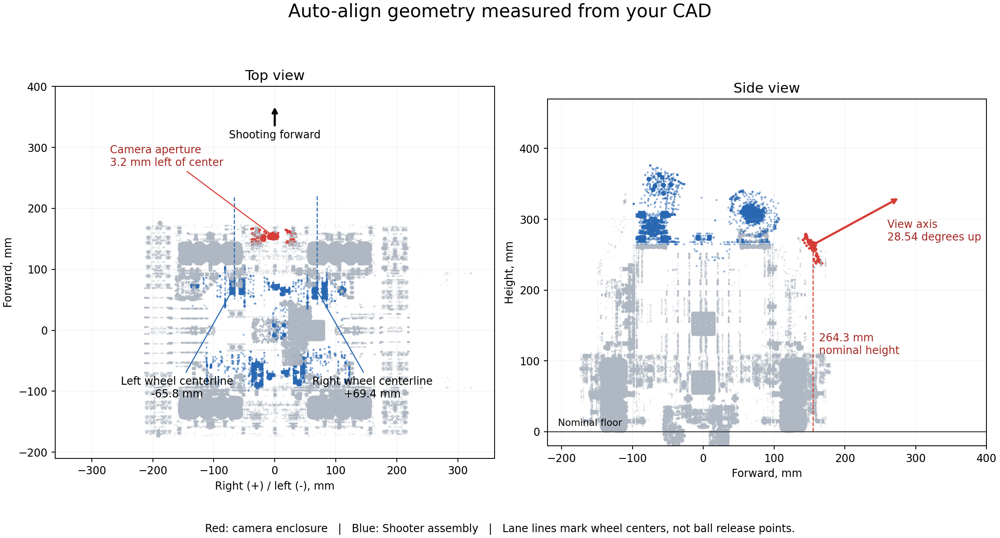

# Camera and shooter geometry from the robot CAD

Measured on 2026-10-24 from the team's **Full robot cad.3mf**, rather than from
perspective-image pixels. The team confirmed that the physical assembly matches
this CAD and that the shooter fires toward the Limelight side.

## Coordinates and measurements

The 3MF declares **meters**. It contains 321 object definitions and 1,313 mesh
instances after resolving nested component transforms. Assembly coordinates are
not automatically robot driving coordinates.

For this aiming feature, forward is the confirmed shooting direction, **+CAD X**;
right is **-CAD Y**, and up is **+CAD Z**. The origin is the midpoint of the four
drive-wheel centers projected onto the nominal floor. In CAD coordinates that
origin is `(-0.08461795, -0.15558380, -0.09809290)` meters. The floor estimate uses
the modeled axle height minus the nominal 52 mm radius of the 104 mm drive wheels.
Tire compression and assembly tolerances are not measured by this calculation.

| Quantity | CAD-derived value | Meaning |
| --- | ---: | --- |
| Camera aperture right coordinate | -3.18 mm | Slightly left of the chassis midpoint |
| Camera aperture forward coordinate | +155.24 mm | Toward the shooting side from the midpoint |
| Camera aperture height | 264.26 mm | Above the nominal floor |
| Camera pitch | +28.5382 degrees | Optical-axis direction tilted upward |
| Camera roll | 0 degrees | Modeled camera is upright |
| Camera yaw relative to shooting forward | 0 degrees | Camera and confirmed shooting direction agree in plan view |
| Left shooting-wheel centerline | -65.83 mm | Left of the midpoint, looking in the shooting direction |
| Right shooting-wheel centerline | +69.37 mm | Right of the midpoint, looking in the shooting direction |
| Separation of the shooting-wheel centerlines | 135.20 mm | Do not aim from an invented central shooter |

Values shown to hundredths of a millimeter document the CAD calculation; they do
not claim that accuracy for the assembled robot or the camera's vision estimates.

The top view's two dashed lines are **wheel-center references**, not calibrated
ball release trajectories. The camera aperture is 62.65 mm to the right of the
left wheel centerline and 72.55 mm to the left of the right wheel centerline.
At a hypothetical 2 m forward distance, those lateral differences alone correspond
to about 1.79 and 2.08 degrees. Actual corrections also depend on release location
and distance. They are not fixed yaw offsets to enter in the configuration.

## Camera measurement provenance

Camera mesh object **8**, `EnclosureTopThin_RC_REAL:1__Solid1`, matches the top
enclosure in the manufacturer's Limelight 3A CAD. Its local dimensions are
72.1054 mm by 48.1054 mm across the face. The local thickness direction is Y.

The front aperture ring is centered at local coordinates
`(0.0360527, -0.0020000, -0.0290527)` meters. Two concentric rings at this plane
have radii 7.7140 mm and 7.9503 mm; each is represented by 58 mesh vertices.
Their centers agree with the circular features in the manufacturer's STEP file.
This checks the lens opening rather than substituting the enclosure's bounding-box
center, which would introduce an additional offset.

Applying object 8's component transform gives the aperture center in CAD space:
`(0.07062222, -0.15240470, 0.16616426)` meters. Its outward front-face normal is
approximately `(0.878499, 0, 0.477745)`. Therefore
`pitch = atan2(0.477745, 0.878499) = 28.538216 degrees`.

**The robot export includes the camera front enclosure, not a labeled calibrated
optical pose origin.** The aperture center is a useful provisional reference,
but the entrance pupil/pose reference may sit behind it. The code now contains
this CAD reference and angle, with `CAMERA_MOUNT_VERIFIED` still false until a
live known-target pose check validates the resulting transform. Changing that
flag alone does not complete the other required calibration.

The source fingerprint, transformation matrix, and full numerical measurements
are recorded in [limelight-cad-measurements.json](limelight-cad-measurements.json).
The original large CAD file is not copied into Git.

## Why the shooter entry remains incomplete

Subassembly **68**, `Shooter <1>`, contains two instances of mesh **71**, the
72 mm Rhino shooting wheel, with separate supports and surrounding geometry.
Their center references in the aiming frame are:

| Reference | Right (m) | Forward (m) | Up (m) |
| --- | ---: | ---: | ---: |
| Left wheel center | -0.06582579 | 0.07243985 | 0.30818390 |
| Right wheel center | 0.06937021 | 0.06511985 | 0.30818390 |

These are not ball exit coordinates. This mesh export has no labeled release
datum, no wiring association with the current `sh1` motor, and no dynamic
compression/ball-flight information. The existing MainTeleOp names one mechanism
`pollenShooter`, but that alone does not associate it with a CAD lane. Picking a
lane from that variable name would be guessing.

Keep `SHOOTER_EXIT_POSITION` unset until the active mechanism's release point is
established. If both lanes will be used, supply a separate calibrated shot profile
for each and reset target acquisition when changing profiles. The current code
supports one configured shooter point; it does not yet select between two lanes.

For horizontal alignment, accurate lateral and forward release coordinates are
the critical shooter inputs. Release height becomes important for shot trajectory
and elevation calibration. The wheel-center height must not be presented as the
ball release height.

## Remaining checks before steering

1. Identify the active shooter lane and its release-point coordinates in these
   same aiming axes. Establish both profiles if both mechanisms are used.
2. With driving disabled, compare reported camera/target poses against a known
   tag position to validate optical origin, signs, and mounting pitch.
3. Add the field's per-tag opening offsets and printed-up vectors. The robot CAD
   contains no hive/tag geometry, so it cannot supply these measurements.
4. Complete the wheel branch's direction checks, then perform the low-power
   steering test described in [limelight-auto-align.md](limelight-auto-align.md).
   MainTeleOp integration still waits for the wheel branch's merge.

The aiming frame is intentionally defined by the shooting direction. The CAD's
drive-wheel axles are parallel to that direction, so the drive code may use a
different forward axis. This update does not rotate joystick commands, change
the IMU orientation, or rename drive corners. Integration must retain the wheel
branch's verified drive conventions and confirm the clockwise turn sign.

CAD improves the starting geometry. It cannot establish tuned steering gains,
camera calibration, traction, shooter RPM, or a first-shot scoring guarantee.

## Manufacturer references

- [Limelight 3A mounting drawing and specifications](https://docs.limelightvision.io/docs/docs-limelight/getting-started/limelight-3a)
- [Official Limelight 3A STEP model](https://downloads.limelightvision.io/cad/LIMELIGHT3ACAD_STEP.stp)
- [Limelight CAD downloads](https://docs.limelightvision.io/docs/resources/downloads)
